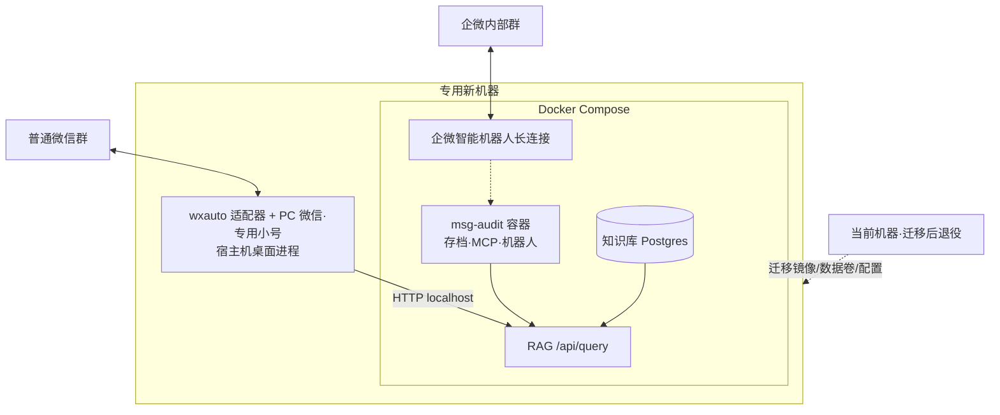
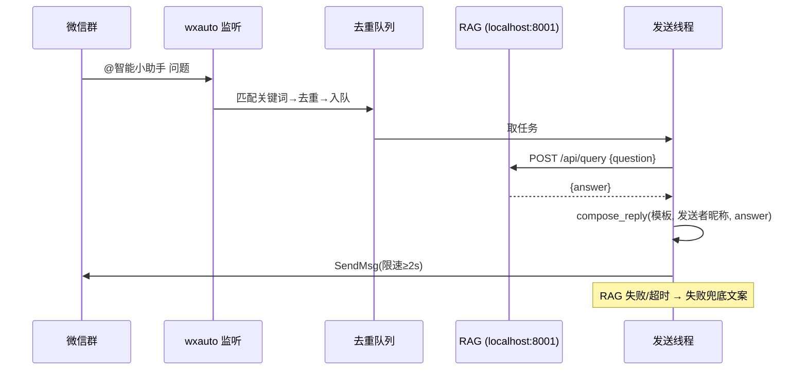

# WeChat Group Bot & Full-Stack Migration - Plan

## Goal Capsule

- **Objective:** 在普通微信群复现企微内部群已验证的智能问答效果（wxauto 试水、两步走），同时将本项目与 aihub-knowledge 打包为 Docker 标准化迁移单元，整体搬迁至专用新机器。
- **Product authority:** 用户（唯一决策人，自行运维）。
- **Open blockers:** 专用微信号未注册；新机器未购置（形态已定：Windows 主机一体）。

---

## Product Contract

### Summary

给普通微信群加「智能小助手」：先用 wxauto（桌面微信 UI 自动化）试水，复用现有 RAG 问答链路与 `@智能小助手` 触发机制，跑通后按真实价值决定是否升级 wcferry。同期将本项目与 aihub-knowledge（含知识库数据）打包为 Docker 标准迁移单元，一键搬迁到专用常驻机器，迁移后全链路自洽，当前机器可退役。

### Problem Frame

企微内部群的问答链路（会话存档 → @检测 → RAG → 智能机器人长连接回复）已验证可用，但业务讨论部分发生在普通微信群与企微外部群，这两类群没有官方机器人通道：企微智能机器人与 webhook 机器人均仅支持内部群；个人微信没有任何官方 API。客户联系 API 的企业群发每月每群仅 4 条且需员工确认，无法承载实时问答。要覆盖这些群，只能官方合规变通（外部群）或灰色自动化方案（个人微信群），二者风险与体验差异极大，需要分路线决策。同时，个人微信自动化方案需要常驻桌面环境，现有机器既跑服务又被日常使用，无法兼任，因此迁移到专用机器成为前置条件。

### Key Decisions

- **wxauto 起步、两步走** — UI 自动化无注入、封号风险最低、当天可跑通；先在真实群验证问答价值，wcferry（hook，能力强但锁微信版本）作为第二阶段备选升级，wechaty（付费 token + Beta）排除。
- **渠道适配层** — 微信渠道只做适配，复用现有 RAG 调用（`wecom_bot/aibot.py` 的 `query_rag`/`extract_answer`/`compose_reply`）与关键词触发机制，不修改已验证的企微内部群链路行为。
- **Docker 标准化迁移** — 镜像经 `docker save`/`docker load` 搬运（规避新机器拉取网络问题），数据卷整体导出导入，配置随迁；wxauto 适配器是唯一宿主机例外（桌面自动化无法容器化）。
- **专用小号 + Windows 主机一体** — 微信机器人使用与常用账号隔离的专用小号；新机器为一台 Windows 主机：Docker Desktop 跑全部容器，wxauto 同机跑桌面微信，迁移脚本与部署按此形态设计。灰色方案封号风险自担。
- **双渠道共用同一 RAG 知识库** — 微信群与企微机器人答案同源，知识库更新同时影响两个渠道。
- **试水先行于当前机器** — 当前机器即 Windows，wxauto 适配器先在本机试水，不等新机器购置；新机器到位后随迁移包整体搬迁。

### Requirements

**微信群机器人（wxauto 试水）**

- R1. 群内 `@智能小助手` 的文本消息触发 RAG 问答，答案以文本回复到原群；触发关键词沿用现有配置机制。
- R2. 微信渠道复用现有 RAG 调用链与同一知识库，不复制问答逻辑。
- R3. wxauto 适配器以渠道适配层接入，不改变已验证的企微内部群链路行为。
- R4. 试水阶段仅支持文本消息收发。
- R5. 适配器异常（微信掉线、发送失败）不影响其他渠道运行，且日志可查、可人工恢复。

**全栈迁移打包**

- R6. 本项目与 aihub-knowledge 打包为可迁移部署单元，覆盖：镜像（docker save/load，含 aihub 应用容器）、数据卷（知识库 Postgres 导出、MinIO 对象桶、BGE 模型卷、消息 JSONL、会话索引、bot 库（gateway.db）、名称缓存、媒体文件）、配置与密钥（.env、RSA 私钥、SDK 动态库）。
- R7. 新机器 `compose up` 后全链路自恢复，各渠道对 RAG 的调用在新机器内部自洽，当前机器可退役。
- R8. 迁移过程固化为可执行的迁移清单/脚本（按单执行），含迁移后验证步骤（消息拉取、群问答、仪表盘）。
- R9. wxauto 适配器运行在 Windows 宿主机桌面，通过本机端口访问容器化 RAG 服务。

**账号与风控**

- R10. 微信机器人仅使用专用小号，不涉及任何常用账号；部署环境与日常用机隔离。

### Actors

- A1. 群成员 — 在普通微信群 @机器人提问的人。
- A2. 运维者（用户） — 执行迁移清单、维护专用小号与常驻机器。
- A3. RAG 服务（aihub-knowledge） — 知识库问答后端，双渠道共用。

### Key Flows

- F1. 微信群问答
  - **Trigger:** 群成员在微信群发送包含 `@智能小助手` 的文本。
  - **Steps:** wxauto 读取群消息 → 关键词匹配 → 调用 RAG（同一知识库）→ 提取答案 → wxauto 模拟输入发送回原群。
  - **Covers:** R1, R2, R3, R4
- F2. 全栈迁移
  - **Trigger:** 用户决定启用专用机器。
  - **Steps:** 当前机器导出镜像/数据/配置 → 传输至新机器 → `compose up` 恢复 → 按验证单核查（拉取、问答、仪表盘）→ wxauto 在新机器登录专用小号 → 当前机器退役。
  - **Covers:** R6, R7, R8, R9

### Acceptance Examples

- AE1. **Covers R1, R2.** 知识库已有相关文档时，群成员 @机器人提问，机器人在原群回复包含知识库答案的文本。
- AE2. **Covers R1, R2.** 知识库无相关内容（空答案）或 RAG 调用失败时，机器人统一回复失败兜底文案（failure_reply_text，与企微渠道同源），不静默、不刷屏。
- AE3. **Covers R7, R8.** 迁移完成后按验证单核查：新机器仪表盘可查历史消息、群问答可用、企微渠道不回归。

### Success Criteria

- 试水期：真实微信群在有人值守时段累计 20 次 @ 问答成功且无误触发，即进入第二阶段（wcferry 升级）评估；连续一周无人值守稳定性判据顺延到迁移后在新机器复核（当前机器日常使用会锁屏，不满足无人值守前提）。
- 迁移：当前机器退役后，消息拉取、双渠道问答、仪表盘功能与迁移前等价。

### Scope Boundaries

- **Deferred for later:** wcferry 升级实施；图片/文件/语音消息收发；企微外部群实施（默认路线为官方合规变通：会话存档收消息 + 企微应用私聊回复提问者）；知识库内容建设。
- **Outside this product's identity:** 不采用 iPad 协议逆向等已死亡/高风险通道（Gewechat、ntchat 已停止维护）。

### Dependencies / Assumptions

- 专用微信号（用户注册）与常驻 Windows 机器（用户购置，Windows 主机一体形态）为外部前置。
- aihub-knowledge 服务与鉴权（X-API-Key）、企微智能机器人 Bot ID/Secret 沿用现有配置。
- 存档拉取依赖 Linux SDK，新机器运行 Docker Desktop（Windows 主机一体形态，迁移脚本按此设计，不含 Linux 主机备选）。
- 假设：个人微信自动化属灰色地带，腾讯自 2025 年起公开打击逆向项目，专用小号存在被封可能，风险由用户自担。
- 假设：外部群官方路线（存档收 + 私聊回）成立但未排期。
- 微信群机器人须使用 wxautox4（付费订阅、一机一码按年）：开源免费版已停更且监听能力为 Plus 专属，免费版无监听不可用。
- 无人值守运行条件：常驻机配置自动登录 + 禁止锁屏（锁屏/RDP 断开会使 UI 自动化失效），微信窗口保持打开不被遮挡，显示器可熄屏。

### Outstanding Questions

- **Resolved During Planning:** 原四项均已解决——适配器进程间通信 → KTD1；RAG 监听地址 → Windows 一体机 localhost 直连（KTD1）；迁移脚本形态 → KTD6；Docker 稳定性规避 → KTD7。
- **Deferred to Implementation:** 微信自动更新锁定的具体操作方式（新版微信客户端策略可能变化，实施时按当时情况确认）。

### Sources / Research

- 官方帮助 21663：智能机器人仅支持内部群（外部群/上下游/互联互通群无回调）— https://open.work.weixin.qq.com/help/wap/detail?docid=21663
- 会话存档外部会话需外部联系人同意 — https://qiyeweixin.apifox.cn/doc-417831
- 企业群发每月 4 条限制 — https://qiyeweixin.apifox.cn/api-10061297
- wcferry（活跃，Python SDK）：https://pypi.org/project/wcferry/
- wxauto 文档：https://docs.wxauto.org/
- wechaty puppet 现状（web 协议已废、Pad 协议 Beta 付费）：https://wechaty.js.org/docs/puppet-providers/wechat
- Gewechat 停止维护声明（腾讯打击后归档）：https://p.codekk.com/detail/Android/Devo919/Gewechat

---

## Planning Contract

Product Contract preservation: unchanged（R/A/F/AE 全部保留）；Key Decisions 补充「试水先行于当前机器」、Dependencies 补充 wxautox4 付费与无人值守运行条件（均为规划期确认的增量，无产品范围变更）。

### Key Technical Decisions

- **KTD1. 适配器独立进程 + 直接复用** — wxauto 桥是一个独立 Python 进程（`wecom_bot/wxbridge.py` 可独立运行），直接 import `wecom_bot.aibot` 的 `query_rag`/`extract_answer`/`compose_reply`（无状态函数）并自调 RAG，不经 MCP 服务转发。独立进程使适配器崩溃/微信掉线不影响其他渠道（R5），也避免为本项目服务增加 WebSocket-bridge 端点。
- **KTD2. callback 收发隔离** — wxauto 的监听 callback 内不可执行发送操作（官方约束）：callback 只做关键词匹配与入队（进程内 `queue.Queue`），独立工作线程消费队列、调 RAG、按限速间隔调 `SendMsg` 回群。
- **KTD3. 消息去重自实现** — wxauto 轮询可能重复投递同一消息：进程内保留近期消息键（群名+发送者+内容+时间）的有界集合做去重，命中即跳过。
- **KTD4. 发送限速与积压保护** — 回复发送间隔不低于 2 秒（风控约束），队列串行发送；队列设深度上限（默认 10，满则丢弃最旧任务），连续 3 次 RAG 超时/失败进入 60 秒熔断窗口，窗口内直接以失败兜底文案快速回复，不再等满 120 秒超时；RAG 响应超时 120 秒沿用现有配置。限速、队列上限、熔断参数均入 WXBotConfig 可配置。
- **KTD5. 单测与真机分离** — wxautox4 为付费闭源 API：单元测试以 fake 客户端对象模拟 `AddListenChat`/`SendMsg`；真实群验收为人工步骤（AE1/AE2 现场核验）。
- **KTD6. 迁移脚本 PowerShell 双段式** — `export`（当前机器：docker save + pg_dump + data 打包 + manifest）与 `import`（新机器：docker load + 恢复 Postgres + 解包 + compose up + 验证单）分离，中间产物为一个目录（移动硬盘/局域网拷贝均可）。
- **KTD7. Docker 引擎看门狗** — Windows 计划任务每 5 分钟探活 `docker info`（显式超时），连续失败则执行 `wsl --shutdown` + 重启 Docker Desktop（本会话已验证的恢复序列），并写日志。
- **KTD8. RAG_API_URL 双视角寻址** — 同一 `.env` 中 `http://127.0.0.1:8001` 对容器内进程与宿主机进程语义不同：容器内 aibot 须使用 `http://host.docker.internal:8001`（或统一 compose 网络后的服务名），宿主机 wxbridge 使用 `http://127.0.0.1:8001`。import 脚本对容器侧配置做转换，V3 验证单增加容器内 RAG 连通性检查项。

### Assumptions

- wxautox4 激活码一机一码：迁移到新机器时需重新激活/换绑（购买时确认换绑政策）。
- 锁屏使 UI 自动化失效为官方文档部分验证 + 社区共识；显示器熄屏对 UIA 无影响为未验证假设，试水期核验。
- 微信 4.x「实时渲染」导致监听失效的风险以官方缓解措施（`resize=True` 自动拉大窗口）应对，极端消息洪峰场景可能仍丢消息——试水群规模小，可接受。

---

## Implementation Units

### U6. aihub-knowledge 应用容器化（迁移前置）

- **Goal:** 为 RAG 应用本体构建 Docker 镜像并纳入其 compose 编排——当前 aihub 应用以宿主机 uv 进程运行，无可 `docker save` 的镜像，是迁移链路的缺失环节。
- **Requirements:** R6, R7
- **Dependencies:** 无（先于 U2 执行；U2/U3 的镜像清单与编排依赖本单元产物）
- **Files:** 位于 aihub-knowledge 仓库（跨仓库改动，用户已授权）：`Dockerfile`（uv 基础镜像 + `uv sync`）、`docker/docker-compose.yml`（新增应用服务接入 postgres/redis 等基础设施网络）；本项目侧仅同步文档引用。
- **Approach:** 应用容器发布 8001 端口（宿主回环绑定，见 KTD8）；U2 镜像清单显式枚举 aihub 应用镜像与基础设施镜像（pgvector/redis/minio/bge-m3/bge-reranker）。
- **Test scenarios:**
  - Integration：容器化 RAG 启动后 `POST /api/query` 返回 200（带 X-API-Key），与宿主机进程行为等价。
  - Edge cases：容器内连 Postgres/MinIO 用 compose 服务名而非 localhost。
- **Verification:** aihub 全栈 `compose up` 后 health/query 探活通过；宿主机 uv 进程停用（新机器上不再依赖宿主机 Python 环境）。

### U1. wxauto 微信渠道适配器（wxbridge）

- **Goal:** 独立进程监听指定微信群，@关键词触发 RAG 问答并回复原群。
- **Requirements:** R1, R2, R3, R4, R5（实现 F1）
- **Dependencies:** 无（试水在当前机器，不依赖迁移）
- **Files:** `wecom_bot/wxbridge.py`（新建，主程序）、`wecom_bot/config.py`（新增 WXBotConfig 配置段）、`wecom_bot/wxbridge_selftest.py`（新建，单测）、`pyproject.toml`（`wxautox4` 加入依赖——验证命令走 `uv run`，依赖必须入 pyproject；requirements.txt 仅用于容器构建，不加入）、`.env`（新增 WXBOT_* 项）
- **Approach:** 启动时按配置 AddListenChat 目标群（仅显式配置的白名单群，新增群需人工确认）；callback 内做文本提取与 `@智能小助手` 关键词匹配（两侧空白剥离），命中后以（群名, 发送者, 内容, 时间）键去重并入 `queue.Queue`（深度上限默认 10，满则丢弃最旧）；工作线程串行消费：调 `query_rag`（复用 `wecom_bot.aibot`）→ `compose_reply` 渲染（`${user_name}` 取发送者昵称）→ 限速后 `SendMsg(content, who=群名)`；连续 3 次 RAG 失败进入 60 秒熔断窗口（KTD4），窗口内直接发失败兜底文案；RAG 失败或超时发送失败兜底文案（读 .env 的 WXBOT_FAILURE_TEXT，默认内置——不读容器写入的 gateway.db，消除宿主/容器跨边界 SQLite 并发）。异常不退出主循环，记日志；`KeepRunning()` 保活。宿主机仅使用最小化配置副本（RAG 端点/token 与 WXBOT_* 项），完整 .env 与私钥仅存在于容器挂载目录。
- **Technical design:**

- **Patterns to follow:** 渠道适配模式与 `wecom_bot/aibot.py`（`handle_message` 的失败兜底结构）、`load_bot_config` 的 env 读取模式、`_render_reply` 的模板渲染上下文。
- **Test scenarios:**
  - Happy path：含 `@智能小助手` 的文本入队并渲染出 `@昵称 + 答案`（fake RAG 返回 `{"answer": "..."}`）；`Covers AE1` 的进程内部分。
  - Edge cases：不含关键词的消息不入队；重复消息键命中去重不入队；空文本/纯图片消息忽略；答案为空串走失败兜底；队列深度达到上限时丢最旧任务。
  - Error paths：RAG ConnectError/超时 → 回复失败兜底文案（`Covers AE2` 进程内部分）；连续 3 次失败进入 60 秒熔断窗口，窗口内直接快速回复兜底文案不等满超时；SendMsg 抛异常不杀主循环、记日志后继续下一队列项。
  - Integration：队列串行发送间隔 ≥ 配置限速值（时钟注入模拟）；配置解析断言不含采集类变量（最小化凭据面）。
- **Verification:** `uv run python -m wecom_bot.wxbridge_selftest` 全部通过；`wecom_bot.selftest` 38 项回归不破。真机验收（激活 wxautox4、PC 微信登录专用小号、真实群 @ 测试）在 U5 完成后执行。

### U2. 迁移导出脚本（export）

- **Goal:** 当前机器一键产出完整迁移包目录。
- **Requirements:** R6（实现 F2 导出段）
- **Dependencies:** 无
- **Files:** `scripts/migrate/export.ps1`（新建）
- **Approach:** 步骤化输出到 `-OutputDir`（默认 `migration_pack`）：⓪停止写入源——`docker compose stop` 本项目与 aihub 两个项目（避免 WAL/JSONL 撕裂快照），打包完成后再 `start`，manifest 记录停机时间窗；①`docker save` 本项目与 aihub-knowledge 相关镜像为 tar（镜像清单含本项目自建镜像 + aihub 应用镜像 + pgvector/redis/minio/bge-m3/bge-reranker 基础镜像）；②`pg_dump` 知识库——经 `docker compose exec -T <aihub 的 pg 服务> pg_dump` 在容器内执行（宿主机无 Postgres 客户端且版本需匹配），manifest 记录 Postgres 镜像 tag 与 `pg_dump --version`；③打包本项目 `data/`（JSONL、会话索引、gateway.db、name_cache、媒体）与 aihub 数据卷——MinIO 对象桶（`mc mirror` 导出，上传文档实际存于 MinIO 而非普通目录）、`bge_m3_data`/`bge_reranker_data` 模型卷（docker run + tar）；④拷贝 `.env`（双方）、`sdk/` 与 `secrets/` 目录（含 private_key.pem、libWeWorkFinanceSdk_C.so，路径以 docker-compose.yml 卷挂载为准）、docker-compose 文件；⑤生成 `manifest.json`（文件清单 + 校验和 + 导出时间）；⑥将产物压缩为 AES-256 加密归档（如 `7z -p`）——迁移包含全部凭据与已解密聊天记录，遗失即重大泄露，解压密码经独立渠道（口头/密码管理器）传递，绝不与归档同介质存放。任一步失败即中止并报告。
- **Test scenarios:**
  - Edge cases：`data/` 缺文件时警告不中止；镜像名不存在时中止并列出本机镜像供核对。
  - Integration：产物目录含 manifest 且校验和与文件实际一致（脚本自校验）。
- **Verification:** 在当前机器完整跑一遍产出迁移包；`Test expectation:` 脚本本身以 dry-run 参数 `-WhatIf` 支持演练，不落盘。

### U3. 迁移导入脚本（import）+ 操作清单

- **Goal:** 新机器按单恢复全栈并完成验证。
- **Requirements:** R7, R8, R9（实现 F2 恢复段，验收 AE3）
- **Dependencies:** U2, U6
- **Files:** `scripts/migrate/import.ps1`（新建）、`scripts/migrate/MIGRATION.md`（新建，操作单）
- **Approach:** 步骤：前置检查（Docker 可用、磁盘空间）→ 解压加密归档并按 manifest.json 逐文件校验校验和（任一不一致即中止，校验不过不得继续）→ `docker load` 全部镜像 → 解包 data/ 与数据卷 → 启动 Postgres（用 docker load 进来的同一 Postgres 镜像，保证 pg_restore 版本匹配）并 `pg_restore` 知识库 → 恢复 MinIO 桶与 BGE 模型卷 → 对容器侧 env 做 RAG_API_URL 转换（容器内 aibot 写 host.docker.internal:8001，见 KTD8）→ `docker compose up` 本项目 → health 探活 + 容器内 RAG 连通性检查（`docker compose exec` 内 curl RAG）→ 输出验证单（拉取消息、@问答、仪表盘）供人工逐项勾选。`-Rehearsal` 演练模式：自动生成 compose override（剥离 container_name、重映射 8331/5482/6382/9082/8082/8083 等端口）后启动演练栈，避免与生产栈冲突。MIGRATION.md 覆盖：新机器初始化（Docker Desktop、wxautox4 激活、PC 微信登录专用小号、自动登录+禁锁屏配置——标准步骤引用 docs/deploy-wechat-bot.md，不重复维护）、执行顺序、常见故障回退（Docker 引擎僵死恢复序列、Postgres 恢复失败重跑）、**退役清机章节**：验证通过后删除两端机器上的 migration_pack、.env、secrets/、data/ 并清空回收站，退出 PC 微信与 wxautox4 授权；若旧机器将离开用户完全控制则重装系统，并在企微后台轮换 MSGAUDIT_SECRET/EXTERNAL_CONTACT_SECRET（此节加入验证单勾选项）。
- **Test scenarios:**
  - Integration：`import.ps1 -Rehearsal` 在当前机器对导出包做一次演练导入（override 剥离容器名/重映射端口），验证演练栈容器启动、health 200、数据量与导出一致。
  - Edge cases：目标目录已有同名数据 → 默认中止，`-Force` 覆盖；manifest 校验不过 → 中止并列出差异文件；Postgres 恢复失败 → 清晰报错并保留现场。
- **Verification:** 演练导入通过（含容器内 RAG 连通检查）+ MIGRATION.md 步骤完整可照做。

### U4. Docker 引擎看门狗

- **Goal:** 引擎僵死（API 500/管道消失）自动恢复，降低无人值守停机。
- **Requirements:** R7（无人值守稳定性支撑，驱动源 KTD7；R5 的进程隔离由 U1/KTD1 满足）
- **Dependencies:** 无
- **Files:** `scripts/wddog/wddog.ps1`（新建）、`scripts/wddog/register-task.ps1`（新建）
- **Approach:** 探活脚本：`docker info` 显式超时/失败 → 记日志 → 恢复前写入带时间戳的 in-progress 标记文件（宽限 15 分钟，覆盖 Docker Desktop 冷启动时长）——标记存在且未超宽限期时本轮只记日志不动手，防止「杀掉-重启-再杀掉」死循环；超宽限仍失败才执行停止 Docker Desktop 进程 → `wsl --shutdown` → 重新启动 Docker Desktop → 轮询恢复；连续 N 次恢复失败则只告警不再尝试（避免风暴）。`register-task.ps1` 注册计划任务每 5 分钟执行。
- **Test scenarios:**
  - Happy path：引擎正常时探活通过、无动作（日志一条 heartbeat）。
  - Error path：注入故障模拟（停止 Docker Desktop）→ 看门狗在一个周期内恢复引擎并记录动作。
- **Verification:** 手动触发一次真实恢复演练；计划任务在任务计划程序中可见且上次结果 0。

### U5. 部署文档与真机验收准备

- **Goal:** 把 wxbridge 运行方式、无人值守桌面配置、wxautox4 激活与验收步骤写成文档。
- **Requirements:** R8, R9, R10
- **Dependencies:** U1, U3, U4
- **Files:** `docs/deploy-wechat-bot.md`（新建）、`README.md`（追加入口链接）
- **Approach:** 文档含：wxbridge 启动/停止（前台试水与计划任务常驻两种）、`.env` 新增项说明、目标群配置方法、**真机探针步骤（验收清单最前）：登录专用小号后先人工核验 wxauto 提取的消息文本包含字面 `@智能小助手`，并确认机器人在群内显示昵称精确为「智能小助手」**、微信自动更新锁定方法、验收清单（对应 AE1/AE2/AE3）、与企微渠道并存的注意事项（防关键词互相误触发——两渠道关键词一致但消息源不同，天然隔离）。
- **Test scenarios:** `Test expectation: none -- 纯文档单元。`
- **Verification:** 按文档从零在当前机器启动 wxbridge 并完成一次真实群验收（AE1/AE2 现场核验通过）。

---

## Verification Contract

| Gate | 适用 | 命令/方式 | 通过信号 |
|---|---|---|---|
| V1 回归自测 | U1 | `uv run python -m wecom_bot.selftest` | 38/38 PASS |
| V2 适配器单测 | U1 | `uv run python -m wecom_bot.wxbridge_selftest` | 全部 PASS |
| V3 迁移演练 | U2, U3, U6 | `export.ps1` + `import.ps1 -Rehearsal` | 演练栈 health 200、容器内 RAG 连通、数据一致、清单勾完 |
| V4 看门狗演练 | U4 | 手动停 Docker Desktop 触发 | 一个周期内自动恢复 |
| V5 真机验收 | U1, U5 | 真实群 @ 测试（AE1/AE2）+ 企微群回归（AE3 之企微不回归） | 群里收到答案/兜底文案；企微渠道正常 |

---

## Definition of Done

- R1–R5：wxbridge 在真实微信群完成 AE1/AE2 现场验收，V1/V2 通过。
- R6–R9：U6 容器化完成，V3 演练导入通过（含容器内 RAG 连通与数据一致），MIGRATION.md 可照做，wxauto 宿主机访问容器化 RAG 的路径在文档中明确；V4 看门狗为无人值守运维支撑项。
- R10：文档明确专用小号要求，验收使用专用小号。
- V1–V5 全绿；企微内部群既有链路无回归。
